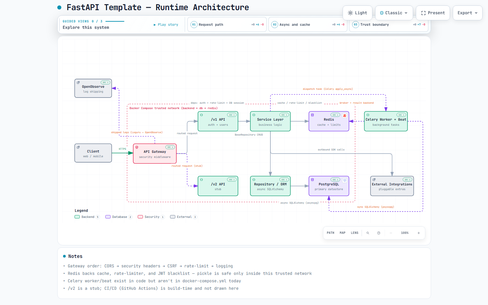

# FastAPI Template

[](https://github.com/eslam5464/Fastapi-Template/actions/workflows/ci.yml)
<!-- --- FEATURE[github_extras] START --- -->
[](https://github.com/eslam5464/Fastapi-Template/actions/workflows/codeql.yml)
<!-- --- FEATURE[github_extras] END --- -->
[](https://github.com/eslam5464/Fastapi-Template/tree/python-coverage-comment-action-data)
[](LICENSE)

A production-ready FastAPI project template with modern best practices, async support, and PostgreSQL integration.

## ✨ Features

- **🚀 FastAPI** - Modern, fast web framework for building APIs, with versioned routers (one mounted app per API version, starting at `/v1`)
- **📊 PostgreSQL** - Async database integration with SQLAlchemy 2.0 and Alembic migrations
<!-- --- FEATURE[auth] START --- -->
- **🔐 JWT Authentication** - Secure token-based authentication
<!-- --- FEATURE[redis_token_blacklist] START --- -->
- **🚫 Token revocation** - logout puts the token on a Redis blacklist
<!-- --- FEATURE[redis_token_blacklist] END --- -->
<!-- --- FEATURE[!redis_token_blacklist] START --- -->
- **⚠️ Logout does not revoke tokens** - without the token blacklist, a logged-out access token stays valid until it expires; keep expiry times short
<!-- --- FEATURE[!redis_token_blacklist] END --- -->
<!-- --- FEATURE[auth] END --- -->
<!-- --- FEATURE[!auth] START --- -->
- **⚠️ No authentication** - every route is public until you add your own login and access checks
<!-- --- FEATURE[!auth] END --- -->
- **🏗️ Clean Architecture** - Repository pattern, dependency injection, and enforced module boundaries (tach)
<!-- --- FEATURE[example_items] START --- -->
- **📦 Example CRUD domain** - Items: a model, repository, service, `/v1/items` endpoints, migration and tests to copy from
<!-- --- FEATURE[example_items] END --- -->
<!-- --- FEATURE[security_headers] START --- -->
- **🔒 Security headers** - OWASP-recommended security headers on every response
<!-- --- FEATURE[security_headers] END --- -->
- **🔒 Security** - Trusted hosts and a CORS allowlist
<!-- --- FEATURE[csrf] START --- -->
- **🛡️ CSRF protection** - Double-submit cookie middleware for browser clients
<!-- --- FEATURE[csrf] END --- -->
<!-- --- FEATURE[redis_rate_limit] START --- -->
- **🚦 Rate limiting** - Redis sliding-window limits as FastAPI dependencies
<!-- --- FEATURE[redis_rate_limit] END --- -->
- **🐳 Docker Compose** - Backend and Postgres ready to run
- **🧪 CI & Testing** - Pytest with coverage gating, plus lint/type/security checks in GitHub Actions

<!-- --- FEATURE[redis_cache|celery|backblaze|gcs|firebase|apple_pay|resend|brevo] START --- -->
Plus optional integrations:

<!-- --- FEATURE[redis_cache|celery|backblaze|gcs|firebase|apple_pay|resend|brevo] END --- -->
<!-- --- FEATURE[redis_cache] START --- -->
- caching
<!-- --- FEATURE[redis_cache] END --- -->
<!-- --- FEATURE[celery] START --- -->
- background jobs
<!-- --- FEATURE[celery] END --- -->
<!-- --- FEATURE[backblaze|gcs] START --- -->
- cloud storage
<!-- --- FEATURE[backblaze|gcs] END --- -->
<!-- --- FEATURE[firebase] START --- -->
- Firebase
<!-- --- FEATURE[firebase] END --- -->
<!-- --- FEATURE[apple_pay] START --- -->
- Apple Pay
<!-- --- FEATURE[apple_pay] END --- -->
<!-- --- FEATURE[resend|brevo] START --- -->
- email delivery
<!-- --- FEATURE[resend|brevo] END --- -->

For the full list of integrations and services, see **[docs/features.md](docs/features.md)**.

## 🚀 Quick Start

### Prerequisites

- [Python 3.14+](https://www.python.org/downloads/)
- [PostgreSQL](https://www.postgresql.org/download/)
- [uv](https://docs.astral.sh/uv/)

### Installation

1. **Clone the repository**

   ```bash
   git clone <your-repo-url>
   cd FastApi-Template
   ```

2. **Install dependencies**

   Create a virtual environment

   ```bash
   python -m venv .venv
   ```

   Activate the virtual environment

   ```bash
   # On Linux / macOS
   source .venv/bin/activate
   # On Windows (PowerShell)
   .venv\Scripts\Activate.ps1
   ```

   Install dependencies

   ```bash
   # Install dependencies (the services chosen at generation are regular dependencies)
   uv sync --all-groups

   # Install pre-commit hooks
   pre-commit install
   ```

   **Note:** If you are facing SSL issues on Windows, use:

   ```bash
   uv sync --all-groups --native-tls
   ```

3. **Set up environment variables**

   ```bash
   cp .env.example .env
   # Edit .env with your configuration
   ```

4. **Configure database**

   ```bash
      # Create database
      createdb fastapi_template

      # Run migrations
      alembic upgrade head
   ```

5. **Start the development server**

   ```bash
      python main.py
   ```

The API will be available at `http://localhost:8799` with interactive documentation at:

- `http://localhost:8799/v1/docs`
<!-- --- FEATURE[api_v2] START --- -->
- `http://localhost:8799/v2/docs`
<!-- --- FEATURE[api_v2] END --- -->

<!-- --- FEATURE[_template] START --- -->
## 🧬 Using This as a Template

This repository doubles as a [Copier](https://copier.readthedocs.io/) template — generate a brand-new FastAPI project from it, with your own name, author info, and settings, without cloning and hand-editing:

```bash
# Run copier directly with uvx - no install/PATH setup needed
uvx copier copy gh:eslam5464/Fastapi-Template <new-project-dir> --trust
```

**Alternative:** if you'd rather have `copier` installed permanently (e.g. for `copier update` later), use `uv tool install copier` instead. On Windows, that installs into a user tools directory that's often **not yet on PATH** in your *current* terminal session — if you see `'copier' is not recognized as an internal or external command` right after installing, either open a **new** terminal window, or run `uv tool update-shell` and then restart the terminal. The `uvx` command above sidesteps the PATH issue entirely since it doesn't need `copier` installed anywhere persistent.

You'll be prompted for a project name, description, author name/email, GitHub username, Python version, and how much of the template to include. The `services` question offers three values: `minimal` (the base, pre-selected in an interactive run), `custom` (choose optional services one by one), or `full` (everything). `copier copy ... --defaults` selects `full`, so it generates the project with every optional service; for a scripted minimal base use `copier copy ... --defaults --data services=minimal`. The optional services are authentication, the example Items domain, the `/v2` API scaffold, the CSRF middleware, the security headers middleware, the Redis cache, rate limiting, the token blacklist, Celery, Firebase, Firestore, Google Cloud Storage, BackBlaze B2, Resend, Brevo, OpenObserve, Apple Pay, the Alembic helper scripts, the GitHub extras (CodeQL, Dependabot, issue and pull request templates, CODEOWNERS, SECURITY.md) and the extra documentation (guides, architecture, API reference, runbooks, strategy). Everything identity-specific — the `pyproject.toml` name, Docker container names, the Postgres schema, `README.md`, `LICENSE`, `CODEOWNERS` — is filled in automatically; see [docs/features.md](docs/features.md) for what ships by default versus what's opt-in.

`--trust` is required because generation runs a small post-processing script (`scripts/generate/post_gen.py`) that substitutes your answers into the copied files, removes unused Apple Pay files when you opt out, regenerates `uv.lock`, and runs `git init` for you.

This repo itself stays fully runnable the whole time — the template mechanics live entirely in `copier.yml` and `scripts/generate/post_gen.py`, which run *after* copying and edit the same real files you already build, test, and run directly. There are no separate `.jinja` template files to keep in sync.
<!-- --- FEATURE[_template] END --- -->

## 🤖 AI Coding Assistant Support

This repo packages its whole architecture — layering rules, SQLAlchemy patterns, auth/
security conventions, testing gotchas, CI/tooling config, and the Copier generation
mechanics above — as something an AI coding assistant can actually use, not just read
about. It has two jobs, for whichever assistant you use:

- **Scaffold a brand-new project** with this architecture by driving the real Copier
  template (not re-typing boilerplate from memory, so it can't drift from what's
  actually here).
- **Extend or review** an existing instance of this architecture — this repo, or any
  project generated from it — adding new endpoints/services/models consistently with
  what's already there, or auditing a diff/codebase against the documented rules and
  anti-patterns catalog before you merge it. Reviews always list what's wrong and why,
  and what's suggested instead, and leave applying any fix up to you.

### Install it in another project — one command, any of 76+ agents

The canonical source lives at
[`.claude/skills/fastapi-template-architect/`](.claude/skills/fastapi-template-architect/)
in [Agent Skills](https://code.claude.com/docs/en/skills) format (portable — not
Claude-specific). To pull it into an unrelated project for **Claude Code, Codex CLI,
GitHub Copilot, Cursor, Windsurf**, or any other agent supported by
[`skills` (vercel-labs/skills)](https://github.com/vercel-labs/skills), run this from
that project:

```bash
npx skills add eslam5464/Fastapi-Template --skill fastapi-template-architect
```

Add `-g` to install it once to your personal/global skills folder instead of just this
project, or `-a claude-code` / `-a codex` to target one agent specifically. This is a
real, general-purpose skill installer, not something built for this repo — it works
the same way for anyone else's skills too.

A skill installed this way (or copied, below) carries reference copies of key template
files in its `assets/` folder, shown with every optional service included. In a project
generated from this template, those copies match the services that project has.

> GitHub Copilot support in that CLI is unverified as of this writing — Copilot's own
> docs don't describe a native skills-folder mechanism yet. If `-a github-copilot`
> doesn't do anything for you, use the Copilot-specific files below instead.

### Working in this repo, or in a project generated from it? Nothing to do

Each of these is auto-discovered with zero install step, for the same reason: every
project generated from this template inherits them automatically, just like the rest
of the architecture.

- **Claude Code** scans [`.claude/skills/`](.claude/skills/fastapi-template-architect/).
- **Codex CLI** scans [`.agents/skills/`](.agents/skills/fastapi-template-architect/) —
  a mirror of the Claude Code skill (same `SKILL.md` format), regenerated from it by
  [`scripts/sync_skill_mirrors.py`](scripts/sync_skill_mirrors.py) and kept in sync by
  a pre-commit hook.
- **GitHub Copilot** reads
  [`.github/copilot-instructions.md`](.github/copilot-instructions.md) automatically,
  plus two reusable Copilot Chat prompts once `chat.promptFiles: true` is set in VS
  Code: [`/fastapi-scaffold`](.github/prompts/fastapi-scaffold.prompt.md) and
  [`/fastapi-review`](.github/prompts/fastapi-review.prompt.md). Reusing these in
  another repo today means copying those files there — Copilot has no cross-project
  installer of its own yet.

### Fallback: manual copy/symlink (if you'd rather not run `npx`)

```bash
# macOS/Linux
cp -r .claude/skills/fastapi-template-architect ~/.claude/skills/
```

```powershell
# Windows (PowerShell) - a junction instead of a copy keeps it in sync automatically
New-Item -ItemType Junction -Path "$env:USERPROFILE\.claude\skills\fastapi-template-architect" -Target "$PWD\.claude\skills\fastapi-template-architect"
```

See the skill's own [SKILL.md](.claude/skills/fastapi-template-architect/SKILL.md) for
the full detail on both modes.

## 📖 Documentation

Detailed documentation is available in the [docs/](docs/) folder:

- **[LLM Index](docs/llms.txt)** - Canonical documentation entrypoint for AI and quick doc navigation
- **[AI Coding Assistant Skill](.claude/skills/fastapi-template-architect/SKILL.md)** - Scaffold or extend/review projects with this architecture from Claude Code, Codex CLI, or GitHub Copilot
- **[Features](docs/features.md)** - Full list of integrations and services, with setup notes
<!-- --- FEATURE[extra_docs] START --- -->
- **[Architecture Overview](docs/architecture/overview.md)** - Current system design and versioned routing model
- **[Backend Architecture Guide](docs/backend-architecture.md)** - Layered architecture deep dive
- **[API Reference](docs/api/reference.md)** - Versioned endpoint reference
- **[Getting Started](docs/guides/getting-started.md)** - Setup and first run
- **[Development Guide](docs/guides/development.md)** - Local workflow and quality commands
- **[Contributing](docs/guides/contributing.md)** - Contribution and PR standards
- **[Versioning](docs/guides/versioning.md)** - SemVer rules and how to bump the release version
- **[Deployment Guide](docs/guides/deployment.md)** - Production deployment checklist
- **[Strategy Vision](docs/strategy/vision.md)** - Product and technical direction
- **[Roadmap](docs/strategy/roadmap.md)** - Milestones and priorities
<!-- --- FEATURE[extra_docs] END --- -->
- **[Changelog](docs/changelog/CHANGELOG.md)** - Release history

<!-- --- FEATURE[extra_docs] START --- -->
## 🏛️ Architecture

See **[Architecture Overview](docs/architecture/overview.md)** for the layers, request flow and module boundaries.

<!-- --- FEATURE[extra_docs] END --- -->
<!-- --- FEATURE[_template] START --- -->
<picture>
  <source media="(prefers-color-scheme: dark)" srcset="docs/architecture/fastapi-template.architecture.visual-check.1440x900.dark.png">
  
</picture>

*Screenshot of the interactive diagram — client → API Gateway → versioned API → Service Layer → Repository/ORM → PostgreSQL, with Redis-backed caching/rate-limiting/token-blacklisting and an optional Celery worker for background jobs, all inside the Docker Compose trusted network.*

The interactive version of this diagram lives at [`docs/architecture/fastapi-template.architecture.html`](docs/architecture/fastapi-template.architecture.html) — download it and open it locally for guided views, theme toggling, and per-node source links (GitHub renders `.html` files as source, not a live page, so the link above won't run it in-browser).

<!-- --- FEATURE[_template] END --- -->

## 🏗️ Project Structure

```text
├── app/
│   ├── api/                 # API routes and endpoints
│   │   └── v1/             # API version 1
│   │       ├── endpoints/  # Individual endpoint modules
│   │       └── deps/       # Route dependencies
│   ├── core/               # Core functionality
│   │   ├── config.py       # Configuration management
│   │   ├── db.py           # Database connection
│   │   └── exceptions/     # Custom exceptions
│   ├── models/             # SQLAlchemy models
│   ├── schemas/            # Pydantic schemas
│   ├── repos/              # Repository pattern implementations
│   ├── services/           # Business logic and external services
│   ├── middleware/         # Custom middleware
│   └── alembic/            # Database migrations
├── docs/                   # Detailed documentation
├── scripts/                # Utility scripts
└── logs/                   # Application logs (Generated at runtime)
```

<!-- --- FEATURE[auth] START --- -->
## 🔐 Authentication

JWT authentication with a User model: signup, login, access and refresh tokens, Argon2 password hashing, and a `get_current_user` dependency for protected routes. See **[docs/integrations/auth.md](docs/integrations/auth.md)** for the endpoints, the settings and how to protect a route.

<!-- --- FEATURE[auth] END --- -->

## 🛠️ Development

### Code Quality

The project includes several tools for maintaining code quality:

- **Black** - Code formatting
- **Pre-commit hooks** - Automated checks before commits
- **Loguru** - Structured logging
- **Environment validation** - Pydantic settings

### Testing

The project maintains comprehensive test coverage with **~90% code coverage** across all modules:

```bash
# Run all tests with verbose output and detailed reporting
uv run pytest -v

# Run tests with coverage report
uv run pytest tests/ --cov=app --cov-report=term --cov-report=html

# View detailed HTML coverage report
# Open htmlcov/index.html in your browser
```

**Coverage Scope:**

- ✅ Unit, service, and integration tests
- 📊 Terminal and HTML coverage reports
- 🎯 Tests cover the API, database operations, services, middleware, and utilities

### Security Analysis

Run security analysis using Bandit:

```bash
uv run bandit -r app -f json -o bandit_results.json
```

### Running Tests

```bash
uv run pytest -v
```

<!-- --- FEATURE[celery] START --- -->
### Background Jobs & Task Queue

Celery workers, the beat scheduler and the sample tasks: see [docs/integrations/celery.md](docs/integrations/celery.md).

<!-- --- FEATURE[celery] END --- -->

### Database Migrations

<!-- --- FEATURE[alembic_scripts] START --- -->
Use the helper scripts (Recommended):

```bash
# Run database migrations for linux/macOS
./scripts/alembic.sh

# Run database migrations for windows
.\scripts\alembic.bat
```

<!-- --- FEATURE[alembic_scripts] END --- -->
Use Alembic commands directly:

```bash
# Create a new migration
alembic revision --autogenerate -m "Description"

# Apply migrations
alembic upgrade head

# Rollback migrations
alembic downgrade -1
```

## 🌍 Environment Configuration

The application supports multiple environments:

- **local** - Development with debug features
- **dev** - Development server
- **stg** - Pre-production testing (Staging)
- **prd** - Production deployment

Configure via environment variables or `.env` file:

```env
# Database
POSTGRES_HOST=localhost
POSTGRES_PORT=5432
POSTGRES_USER=postgres
POSTGRES_PASSWORD=your-postgres-password
POSTGRES_DB=postgres
POSTGRES_DB_SCHEMA=fastapi_template

# Server
BACKEND_HOST=localhost
BACKEND_PORT=8799
CURRENT_ENVIRONMENT=local
```

<!-- --- FEATURE[auth] START --- -->
Authentication:

```env
SECRET_KEY=your-secret-key
ACCESS_TOKEN_EXPIRE_SECONDS=3600
REFRESH_TOKEN_EXPIRE_SECONDS=2592000
```

<!-- --- FEATURE[auth] END --- -->
<!-- --- FEATURE[redis] START --- -->
Redis (shared by the Redis-backed services this project uses):

```env
REDIS_HOST=localhost
REDIS_PORT=6379
REDIS_PASS=your-redis-password
```

<!-- --- FEATURE[redis] END --- -->
<!-- --- FEATURE[redis_rate_limit] START --- -->
Rate limiting:

```env
RATE_LIMIT_ENABLED=true
RATE_LIMIT_DEFAULT=100
RATE_LIMIT_WINDOW=60
```

<!-- --- FEATURE[redis_rate_limit] END --- -->
<!-- --- FEATURE[celery&auth] START --- -->
Celery user seeding:

```env
ENABLE_DATA_SEEDING=false
SEEDING_USER_COUNT=100
```

<!-- --- FEATURE[celery&auth] END --- -->
<!-- --- FEATURE[resend] START --- -->
Resend:

```env
RESEND_API_KEY=your_resend_api_key_here
```

<!-- --- FEATURE[resend] END --- -->
<!-- --- FEATURE[brevo] START --- -->
Brevo:

```env
BREVO_API_KEY=your_brevo_api_key_here
```

<!-- --- FEATURE[brevo] END --- -->
`.env.example` lists every variable this project uses.

## 📦 Dependencies

Core dependencies (FastAPI, SQLAlchemy, Alembic, Pydantic, Uvicorn) are always installed. The packages of the optional services chosen when the project was generated are regular dependencies too, so `uv sync` installs everything the project uses.

See **[docs/features.md](docs/features.md)** for what each service provides and how to configure it.

## 🤝 Contributing

1. Fork the repository
2. Create a feature branch (`git checkout -b feature/amazing-feature`)
3. Commit your changes (`git commit -m 'Add amazing feature'`)
4. Push to the branch (`git push origin feature/amazing-feature`)
5. Open a Pull Request

## 📄 License

This project is licensed under the MIT License - see the [LICENSE](LICENSE) file for details.

## 🙏 Acknowledgments

- [FastAPI](https://fastapi.tiangolo.com/) - The amazing web framework
- [SQLAlchemy](https://sqlalchemy.org/) - The Python SQL toolkit
- [Pydantic](https://pydantic-docs.helpmanual.io/) - Data validation library
- [Fastapi Template by tiangolo](https://github.com/tiangolo/fastapi-template) - A FastAPI project template
- [Fastapi best practices](https://github.com/zhanymkanov/fastapi-best-practices) - Inspiration for best practices
- [Fastapi Tips](https://github.com/Kludex/fastapi-tips) - Useful tips and tricks from FastAPI Expert
- [Fastapi structure](https://github.com/rannysweis/fast-api-docker-poetry) - Project structure inspiration
